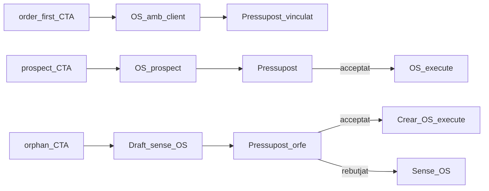

# ua06 — Entrades comercials coexistents (`order_first` + `quote_first`)

> **Estat:** V1 **C** estable (prospect OS). **V2 B+D en curs** — pressupost orfe + composer CDL mínim (2026-10-08).  

> **Pla pare:** `[README.md](./README.md)` · model `[02-domain-model.md](./02-domain-model.md)` · UX camp `[03-ux-contract.md](./03-ux-contract.md)`  
> **Estudi:** pla Cursor `quote-first_options_study`. Spike V2: [`cf24-v2-orphan-spike.md`](./cf24-v2-orphan-spike.md). UAT V2: [`cf24-v2-orphan-uat.md`](./cf24-v2-orphan-uat.md). Vocabulari: [`cf24-closed-vocabulary.md`](./cf24-closed-vocabulary.md).

## Per què existeix aquest document

El Tall 1 del flux comercial és **OS-cèntric** (crear ordre → Full de preus → emetre pressupost). Això encaixa amb field-service urgent, renúncia i sostre `authorized_total` sobre l’OS.

Molts usuaris també esperen el flux clàssic: **contacte / potencial → pressupost → (si s’accepta) feina**. El schema permet `commercial_documents.project_id` NULL; V2 obre el camí productiu sense OS fins a acceptar. `client_id` és **sempre obligatori** al DDL.

## Decisió de producte

| Tema                  | Decisió                                                                                                      |
| --------------------- | ------------------------------------------------------------------------------------------------------------ |
| Convivència           | **Tres inicis** al mateix tenant: ordre, prospecte (C), orfe (V2). Sense mode exclusiu.                      |
| CTAs (criteri usuari) | Veure taula «Quan usar cada CTA».                                                                            |
| Setting               | Opcional: `commercial.preferred_entry` = `order_first` | `quote_first` (preferència UX, **no** interruptor). |
| Contacte              | Obligatori abans d’emetre (`client_id NOT NULL`).                                                            |
| Assessment            | `service_mode = assessment` = visita de camp. **No** és OS prospecte ni orfe.                                |
| Vocabulari plantilles | Contracte tancat; independent del model.                                                                     |
| Formalització         | Sense canviar `formalization_mode` en aquest epic (`signed_quote` | `separate_agreement`).                   |

### Quan usar cada entrada

| Situació                                             | Entrada                                                                                                                                                                                   |
| ---------------------------------------------------- | ----------------------------------------------------------------------------------------------------------------------------------------------------------------------------------------- |
| Feina urgent / visita / ja hi haurà ordre            | **Nova ordre** (order-first) → emetre a **Preparar**                                                                                                                                      |
| Potencial **sense** crear ordre fins que accepti     | `/sales/quotes` → **Nou pressupost** → **Només pressupost** (V2 orfe)                                                                                                                     |
| Cotitzar amb Full de preus ric a l’OS abans d’enviar | `/sales/quotes` → **Nou pressupost** → **Feina amb pressupost** (V1 prospect) → Preparar (Formalització + emetre)                                                                         |
| Ja tens OS oberta                                    | Obre l’ordre → **Preparar** (no hi ha modal d’emissió des de la llista de pressupostos)                                                                                                    |
| Lead web promogut                                    | Promote → contacte → `?orphan=1` → branca **Només pressupost**. No treure `promote_lead_to_contact`.                                                                                      |

### Models

| Opció                                | Estat                                                                                                   |
| ------------------------------------ | ------------------------------------------------------------------------------------------------------- |
| **C** OS `commercial_stage=prospect` | **V1 estable** — migracions `20261230000001`/`00002`; Preparar-only; accept→execute; reject→cancel      |
| **B+D** orphan + composer CDL mínim  | **V2 + hotfix** (`20261231`* + `20261232000001`) — N orphans/client; accept → OS reintentable (opció B) |
| Paritat Full de preus sobre CDL      | **Fora** V2                                                                                             |

**No** reutilitzar `assessment` com a prospecte d’oficina.

## Regles V2 (orfe)

| Tema         | Regla                                                                                                                                                                                |
| ------------ | ------------------------------------------------------------------------------------------------------------------------------------------------------------------------------------ |
| Unicitat     | N orphans `draft`/`issued` per client. Cadena: `client_op_id` / `supersedes_id` + `IS NOT DISTINCT FROM`. Avís soft si ja n’hi ha un d’`issued`.                                     |
| Draft        | Sense `doc_number` fins a issue. Descartar → `cancelled`. Sense auto-cancel 90d a V2.                                                                                                |
| Accept → OS  | **Opció B:** accept consolida sempre; `ensure_project_from_orphan_quote` idempotent/reintentable (firma pot sobreviure rollback — veure spike).                                      |
| Enllaç acord | `prepare` sense projecte OK; post-OS enllaç `commercial_agreement_projects` reintentable.                                                                                            |
| work_gate    | Bloqueig Fer si acord `require_signed_agreement` per `source_quote_id` **sense** fila a `commercial_agreement_projects` (status pending **i** `active`) — UI **i** RPCs punch/start. |
| Cues         | OS creada sense `planned_start` → Agenda **Sense planificar** (no Avui).                                                                                                             |
| Oficina      | Llistat: «Sense ordre» / «OS pendent» sense `project_id`. «OS nova» **només** a fitxa amb `payload.project_created_from_quote`.                                                      |
| Composer     | Camps CDL: kind, name, unit, qty, price, discount_pct, tax_rate. Sense AI/hàbits/cost.                                                                                               |

## Estat del codi

| Peça                | Realitat                                                                        |
| ------------------- | ------------------------------------------------------------------------------- |
| Schema `project_id` | Nullable                                                                        |
| Schema `client_id`  | NOT NULL                                                                        |
| V1 C                | Productiu (prospect OS + Full de preus)                                         |
| V2 orphan RPCs / UI | Hotfix aplicat (`20261232000001`: immutable, gate, membership, event, finalize) |
| Plantilles          | Snapshot CDL; reutilitzables                                                    |

## Seeds i proves

| Tenant        | Rol                                                                    |
| ------------- | ---------------------------------------------------------------------- |
| **Riera**     | Order-first + prospecte; seeds `P-2026-9001`/`9002` = regressió orphan |
| **2n tenant** | UAT intensiu quote-first orfe + prospecte                              |

### Checklist UAT

- [x] Order-first baseline (Riera)
- [x] Quote-first (C) cicle + reject sense feina
- [x] Entrada vendes: un CTA «Nou pressupost» + wizard 2 camins (Només pressupost / Feina amb pressupost); emissió OS només a Preparar
- [x] Contacte potencial vs efectiu
- [x] Stepper/wizard prospecte
- [x] Lead → promote → CTA (destí preferent orfe a V2)
- [x] Amendment / albarà només amb OS execute
- [x] Orfe: draft → línies → issue → accept → OS + línies + Sense planificar (SQL + UI 2026-10-08)
- [x] Orfe: reject → zero OS
- [x] Orfe: N drafts/issued mateix client
- [x] Orfe hotfix: immutable `formalization_mode`/`full_body_template_id` + gate SQL (pending/active sense link) + membership sense `auth.uid` (`20261232000001` + tests)
- [ ] Orfe: UAT manual chip oficina (llistat sense fals «OS nova»; fitxa amb flag) + punch gate amb acord sense enllaç — guió [`cf24-v2-orphan-uat.md`](./cf24-v2-orphan-uat.md) Cas 4–5
- [ ] separate_agreement orphan → UAT prepare/firma/link — guió Cas 5

## Relació amb altres treballs

- Vocabulari: [`cf24-closed-vocabulary.md`](./cf24-closed-vocabulary.md).
- Acords: `formalization_mode` independent.
- Spike V2: [`cf24-v2-orphan-spike.md`](./cf24-v2-orphan-spike.md).
- UAT V2 orphan: [`cf24-v2-orphan-uat.md`](./cf24-v2-orphan-uat.md).
- CF-24 no és prerequisit de CF-19…CF-22.

