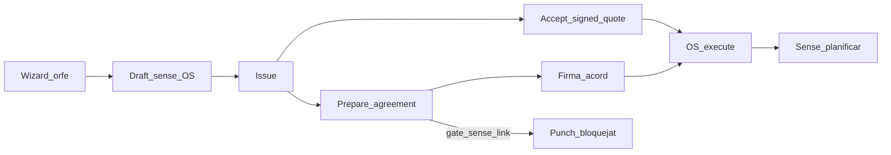

# CF-24 V2 — UAT manual orphan

> **Estat:** pendent d’execució  
> **Spec:** [`06-sales-entry-modes-quote-first.md`](./06-sales-entry-modes-quote-first.md) · Spike: [`cf24-v2-orphan-spike.md`](./cf24-v2-orphan-spike.md)  
> **Tenant per defecte:** Riera (owner/manager). Repetir al 2n tenant si cal intensiu.  
> **Prerequisit:** migracions `20261231*` + `20261232000001` aplicades; sessió oficina autenticada.

## Com registrar

Per cada cas: **PASS / FAIL / BLOCKED** + nota (URL doc, nº, id OS). Temps orientatiu: **45–75 min**.

| Cas | Resultat | Notes |
|-----|----------|-------|
| 0 Preparació | | |
| 1 Happy path `signed_quote` | | |
| 2 Reject zero OS | | |
| 3 N orphans + avís soft | | |
| 4 Chip regressió hotfix | | |
| 5 `separate_agreement` + gate | | |
| 6 Lead → orfe | | |
| 7 Acceptació oficina | | |

---

## Cas 0 — Preparació (5 min)

1. Entrar al tenant Riera com a owner/manager.
2. Triar un **client de prova** (o crear-ne un nou); anotar quants orfes `issued` oberts té.
3. Confirmar CTA a `/sales/quotes`: un sol «Nou pressupost» → wizard amb 2 targetes (**Només pressupost** / **Feina amb pressupost**).
4. (Opcional) Des lead: enllaç `?client_id=…&orphan=1` obre el wizard a la branca Només pressupost.

---

## Cas 1 — Happy path `signed_quote` ☑

| Pas | Acció | Esperat | OK |
|-----|--------|---------|----|
| 1.1 | Nou pressupost → Només pressupost → client → Formalització → Continuar | Esborrany `/sales/quotes/{id}`; **sense** `doc_number`; «Sense ordre» | ☐ |
| 1.2 | Composer ≥1 línia → Formalització/plantilla → Emetre | `issued` + `doc_number`; llistat «Sense ordre» | ☐ |
| 1.3 | Acceptar (oficina / decisió client) | `accepted`; OS auto **o** botó «Crear / reintentar ordre» | ☐ |
| 1.4 | Si pendent: ensure | Toast + navegació SPA a `/field/orders/{id}?tab=prepare` | ☐ |
| 1.5 | Fitxa quote | Chip «Acceptat · OS nova» només amb `project_created_from_quote` | ☐ |
| 1.6 | Llistat `/sales/quotes` | Sense «OS nova» en files amb `project_id` (tampoc order-first) | ☐ |
| 1.7 | Agenda | OS a **Sense planificar**; **no** Avui; `execute` | ☐ |
| 1.8 | OS → línies | Mateixes línies (`source_quote_line_id`) | ☐ |

**FAIL si:** OS a draft/issue; Avui mostra l’OS; llistat «OS nova» en quotes order-first.

---

## Cas 2 — Reject (zero OS)

1. Nou orfe → línies → emetre.
2. Rebutjar (oficina).
3. **Esperat:** `rejected`; `project_id` NULL; cap OS per aquest doc.

---

## Cas 3 — N orphans + avís soft

1. Deixar un orfe en `issued` (mateix client).
2. Obrir de nou el wizard per al mateix client.
3. **Esperat:** avís ambre amb N issued sense ordre; es pot crear un 2n draft.
4. Llistat: dos docs amb «Sense ordre».

---

## Cas 4 — Chip regressió (hotfix)

1. Quote **order-first** acceptada amb `project_id` → llistat **sense** «OS nova».
2. Fitxa orfe acceptat amb OS (Cas 1) → «OS nova» **sí**.
3. Orfe acceptat sense OS → «OS pendent» + ensure OK.

---

## Cas 5 — `separate_agreement` + work_gate

| Pas | Acció | Esperat | OK |
|-----|--------|---------|----|
| 5.1 | Orfe amb formalització `separate_agreement` | Mode correcte a fitxa | ☐ |
| 5.2 | Emetre | `issued`, sense OS | ☐ |
| 5.3 | Prepare amb `work_gate = require_signed_agreement` | Acord creat; sense link projecte (encara no OS) | ☐ |
| 5.4 | Accept / firma acord | Quote `accepted`; OS; idealment `commercial_agreement_projects` | ☐ |
| 5.5 | Punch / start visit amb OS i acord **sense** link | `agreement_work_gate_blocked` | ☐ |
| 5.6 | Després d’enllaç + acord `active` | Punch permès | ☐ |

**Nota:** si l’acord és `active` sense fila a `commercial_agreement_projects`, el punch ha de continuar bloquejat fins a l’enllaç.

---

## Cas 6 — Smoke lead → orfe

1. Leads → «Nou pressupost» / `client_id` + `orphan=1`.
2. Wizard a branca Només pressupost; crear draft (prou si Cas 1 ja PASS).

---

## Cas 7 — Acceptació d’oficina (sense firma)

Prerequisit: Configuració → plantilles comercials → **Acceptació d’oficina** = Activat.

| Pas | Acció | Esperat | OK |
|-----|--------|---------|----|
| 7.1 | Orfe `signed_quote` issued → «Registrar acceptació (oficina)» + motiu | `accepted`; badge «Acceptat per oficina»; OS / ensure com Cas 1 | ☐ |
| 7.2 | Setting OFF | Sense CTA; RPC `office_accept_disabled` | ☐ |
| 7.3 | (Opcional) `separate_agreement` + office accept + `work_gate=require_signed_agreement` | Quote accepted; guia Contracte **no** fet sense acord; punch bloquejat fins acord | ☐ |

---

## Criteri de tancament

- Cas 1–4 PASS.
- Cas 5: prepare + OS + **un** punch bloquejat sense link; link + punch OK si la firma ho permet.
- Cas 6 PASS o BLOCKED (sense leads de prova).
- Cas 7 PASS si el tenant de prova activa office accept (sinó BLOCKED / skip documentat).
- Marcar checklist residual a [`06`](./06-sales-entry-modes-quote-first.md) i nota a [`STATUS.md`](./STATUS.md).

## Ordre d’execució

Cas 0 → 1 → 2 → 3 → 4 → 5 → 6 → 7.
