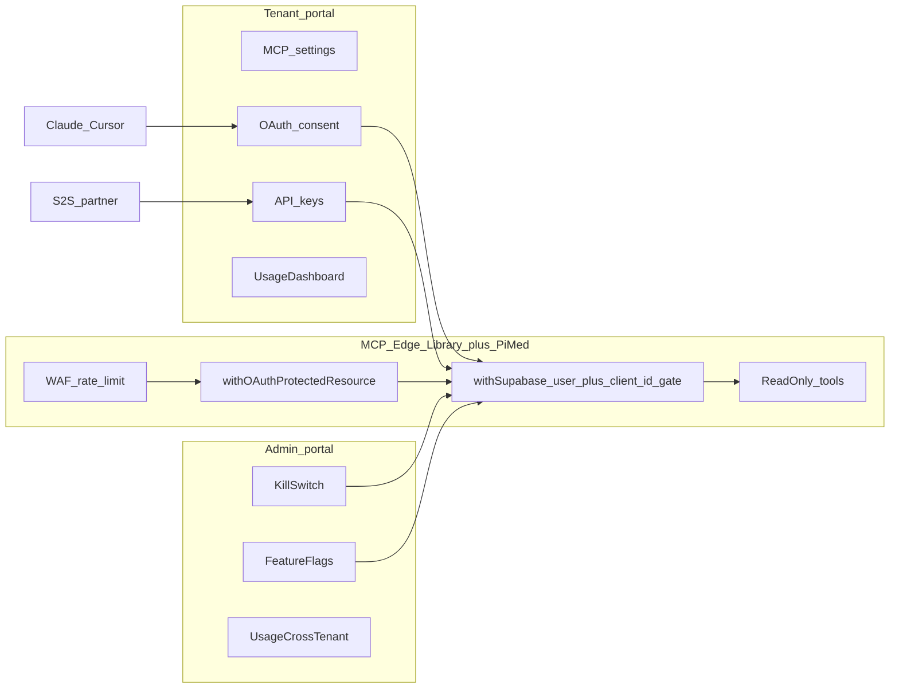

# Servidor MCP públic (SaaS multi-tenant)

> **Estat:** pla documental actualitzat (SELECT 2026 + Library headless MCP), **cap fase implementada** — veure [`STATUS.md`](./STATUS.md) (2026-10-13)  
> **Ordre d’implementació:** [`EXECUTION.md`](./EXECUTION.md)  
> **Depèn de:** Supabase Auth (OAuth 2.1 Server), JWT asimètric (ES256/RS256), RLS multi-tenant, `tenant-portal` + `admin-portal`, CLI ≥ 2.117  
> **Objectiu:** exposar un subconjunt de dades/tools del tenant a agents **externs** (Claude, Cursor, ChatGPT…) amb OAuth per usuaris i API keys per S2S, amb aïllament absolut i controls de plataforma.

| Document | Contingut |
|----------|-----------|
| [`01-architecture-and-security.md`](./01-architecture-and-security.md) | Principis, auth, pipeline Library, jerarquia, rate limit |
| [`02-data-model.md`](./02-data-model.md) | DDL, feature flags, audit events, usage logs |
| [`03-phases-and-backlog.md`](./03-phases-and-backlog.md) | Epics MCP-0…MCP-12, dependències, fora d’abast |
| [`04-acceptance-and-gates.md`](./04-acceptance-and-gates.md) | Criteris d’acceptació i Go/No-Go |
| [`EXECUTION.md`](./EXECUTION.md) | Font de veritat de l’ordre real de treball (agent IA) |
| [`STATUS.md`](./STATUS.md) | Estat per epic; actualitzar durant la implementació |
| [`plan_mcp_server.md`](./plan_mcp_server.md) | Guia històrica de hardening (referència; decisions noves manen aquí) |

---

## Idea central

Un **resource server MCP** remot (Streamable HTTP, stateless) basat en el bloc [Supabase Library headless MCP](https://supabase.com/library/docs/headless/mcp), amb capa PiMed multi-tenant a damunt:

1. Bootstrap: `npx shadcn@latest add @supabase/mcp` (+ OAuth Consent block); **no** copiar fitxers del registry JSON a mà.
2. Autentica **clients externs** via **OAuth 2.1 + PKCE** (Supabase Auth = AS) amb **`client_id` obligatori**.
3. Autentica **integracions machine** via **API keys** hashed (`mcp_live_` / `mcp_test_`).
4. **No** accepta JWT de sessió del portal a l’endpoint públic (confused deputy). Agents embebits del producte → xat/function calling intern, **no** aquest MCP.
5. Resol tenancy amb **`mcp_client_grants`** + URL scoped (OAuth) o binding a la key (S2S), mai amb arguments de tool.
6. Executa tools **read-only** (MVP) amb client RLS + `WHERE tenant_id` (+ `site_id` si aplica). **Sense `supabaseAdmin` al ToolContext.**

---

## Decisions tancades

| Decisió | Valor |
|--------|--------|
| Bootstrap | Library: `npx shadcn@latest add @supabase/mcp` (+ Consent); CLI ≥ 2.117 |
| Modes d’auth (MCP públic) | **OAuth extern** (`client_id` + grants) + **API keys S2S** |
| Session JWT / embedded Library | **Prohibit** a l’endpoint públic; xat intern separat |
| DCR OAuth | **ON** (`allow_dynamic_registration = true`) + monitoring + UI revoke |
| JWT signing | **Asimètric** ES256/RS256 (HS256 rebutjat per `@supabase/server`) |
| Activació | Cascada fail-closed: kill switch → flags globals → override admin → settings tenant |
| Submodes | `mcp_oauth_enabled` i `mcp_api_keys_enabled` independents |
| Tenancy OAuth | Grant table `(user_id, oauth_client_id, tenant_id, site_id?)` + URL scoped |
| Tools MVP | **Read-only**; allowlist ≠ catàleg xat intern; no copiar write del tutorial Library |
| Transport / host | Streamable HTTP **stateless** a **Edge Function**; **no** Supabase Compute |
| Custom domain | `MCP_AUTH_ISSUER` = issuer del projecte si el resource no va per `*.supabase.co` |
| Audit / telemetria | `data.audit_logs` (cicle de vida) · `mcp_usage_logs` (requests) |
| Rate limit pre-auth | WAF / Upstash — **no** memòria local d’Edge |
| Relació amb xat IA | Producte separat; [`../ai/chat_tools_function_calling_plan.md`](../ai/chat_tools_function_calling_plan.md) |

---

## Capes d’activació

1. `MCP_SERVER_FORCE_DISABLED` (env) — emergència.  
2. Feature flags: `mcp_enabled`, `mcp_oauth_enabled`, `mcp_api_keys_enabled`.  
3. Override per tenant (admin-portal).  
4. Settings del tenant + política d’usuaris OAuth.  
5. Credencial vàlida (OAuth amb `client_id` + grant, o API key) + membresia / binding.

---

## Fora d’abast (MVP)

- Tools d’escriptura / `propose_*` sense confirmació humana.  
- Session JWT / agents embebits via aquest MCP (Library ho documenta; PiMed no l’usa aquí).  
- Connectors MCP de tercers al xat intern.  
- Scopes OAuth custom (usar grants + `allowed_tools`).  
- Billing per request; hosting a Supabase Compute.  

---

## Referències externes

- [Library — MCP Server (headless)](https://supabase.com/library/docs/headless/mcp) — **guia d’instal·lació preferida**  
- [SELECT 2026 — Build anything](https://supabase.com/blog/select-2026-build-anything)  
- [Deploy MCP servers (BYO)](https://supabase.com/docs/guides/ai-tools/byo-mcp)  
- [MCP Authentication](https://supabase.com/docs/guides/auth/oauth-server/mcp-authentication)  
- [Makerkit — MCP + OAuth](https://makerkit.dev/blog/tutorials/build-mcp-server-oauth) (tenancy / `client_id`)  
